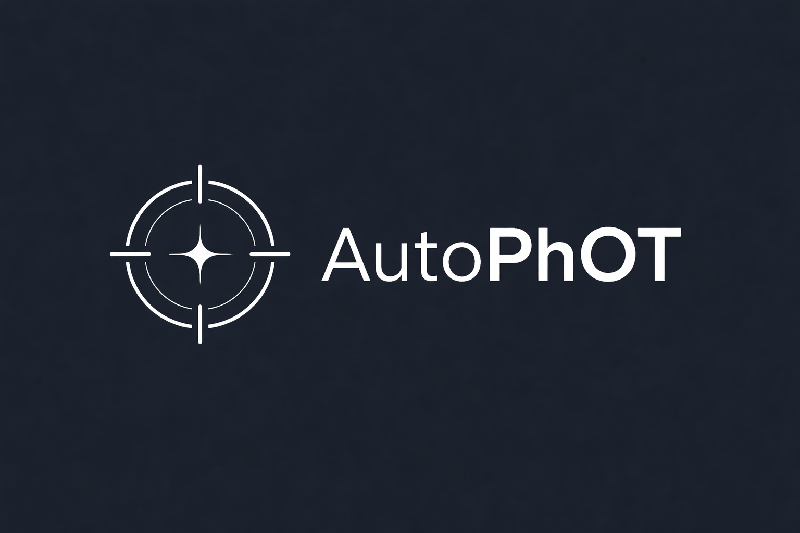
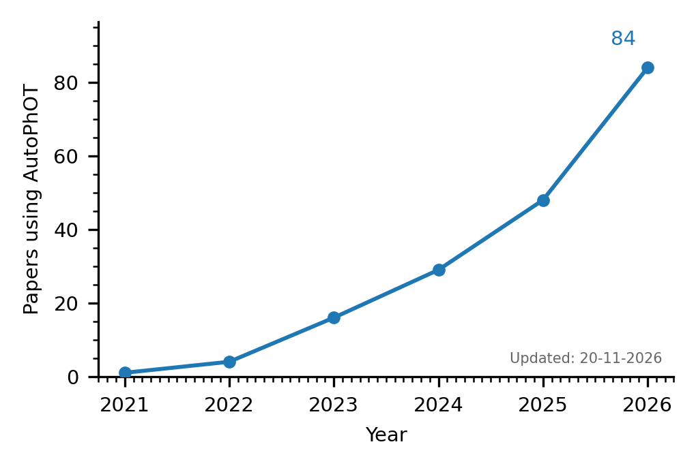

<div align="center">



<h1>AutoPhOT: Automated Photometry Of Transients</h1>

**Point it at your FITS frames, give it a target, get back a calibrated light curve.**

[](https://anaconda.org/astro-sean/autophot)
[](https://anaconda.org/astro-sean/autophot)
[](https://anaconda.org/astro-sean/autophot)
[](https://anaconda.org/astro-sean/autophot)

[Conda package](https://anaconda.org/astro-sean/autophot) | [Paper](https://ui.adsabs.harvard.edu/abs/2022A%26A...667A..62B) | [Report an issue](https://github.com/Astro-Sean/autophot/issues)

</div>

---

AutoPhOT processes FITS images of transients and variable sources. Built on [Photutils](https://photutils.readthedocs.io/) and [Astropy](https://www.astropy.org/), it locates a target in each frame, measures its flux, calibrates the measurements against survey catalogs, and builds a light curve. It supports different telescopes, filters, and pixel scales.

It has been used in <!-- citation-count -->84<!-- /citation-count --> papers so far (updated: <!-- citation-date -->20-11-2026<!-- /citation-date -->; [full list on SciX](https://scixplorer.org/search?q=citations%28bibcode%3A2022A%26A...667A..62B%29&sort=date%20desc)).

> [!NOTE]
> One person maintains AutoPhOT. If you find a problem, open an issue on GitHub and I will look into it.

<h2 align="center">What it does</h2>

1. Sorts frames by telescope, instrument, and filter. Checks the WCS or solves it with astrometry.net and Gaia DR3, including SIP and TPV distortion.
2. Rejects cosmic rays and detects satellite trails. Estimates the background and FWHM.
3. Measures the target with aperture and PSF photometry. The PSF is built from stars in the frame.
4. Calibrates against Gaia DR3, Pan-STARRS, SDSS, APASS, 2MASS, Legacy Survey, SkyMapper, and other catalogs. Catalog selection can vary by filter, and Gaia XP supplies synthetic photometry.
5. Can subtract a template with SFFT, HOTPANTS, or ZOGY, then check the difference image quality.
6. Estimates limiting magnitudes by injecting artificial sources and checking which ones are recovered.

<h2 align="center">Installation</h2>

### Conda (recommended)

```bash
conda install -n base -c conda-forge conda-libmamba-solver
conda config --set solver libmamba

conda create -n autophot -c conda-forge -c astro-sean python=3.12 autophot
conda activate autophot

pip install sfft==1.7.3 sip_tpv==1.1  # not on conda channels
```

AutoPhOT requires Python 3.12 and photutils>=3.1. Conda and pip install these dependencies. Check the installation with:

```bash
python -c "from autophot import AutomatedPhotometry; print('OK')"
autophot-main -h
```

### From source

```bash
git clone https://github.com/Astro-Sean/autophot.git
cd autophot
pip install .
```

For a development checkout use `pip install -e .`. Optional extras cover RefCAT2 queries and the non-default aligners: `pip install ".[refcat,aafitrans,spalipy,tweakwcs,chi2-shift]"` or `pip install ".[all]"`.

`environment.yml` pins every dependency if you want a fully reproducible setup:

```bash
conda env create -f environment.yml
conda activate autophot
pip install -e .
```

<h2 align="center">Documentation</h2>

[`docs/autophot_methods.pdf`](docs/autophot_methods.pdf) describes the pipeline stages and the photometry, calibration, and detection methods. It also lists every `default_input.yml` parameter with its default and usage notes. The LaTeX source is `docs/autophot_methods.tex`; its tables are generated from `default_input.yml`.

The [`examples/run_autophot.ipynb`](examples/run_autophot.ipynb) notebook runs template subtraction on real data. Its appendix covers folder layouts, catalog choices, alignment and subtraction options, photometry, and post-processing.

<h2 align="center">Quick start</h2>

```python
from autophot import AutomatedPhotometry

config = AutomatedPhotometry.load()
config["fits_dir"] = "/path/to/your/images"
config["target_name"] = "SN2026abc"
config["target_ra"] = 123.456789
config["target_dec"] = -12.345678

output_file = AutomatedPhotometry.run_photometry(default_input=config)
```

- `from autophot import list_parameters; list_parameters()` prints each config key and its default.
- Include `TELESCOP`, `INSTRUME`, and a bandpass keyword such as `FILTER` in each FITS header. AutoPhOT skips images without these keywords.
- `config["nCPU"] = 4` (or `AUTOPHOT_NCPU=4`, which takes precedence) processes images in parallel, each with its own log. Worker settings like `photometry.aperture_n_jobs` multiply `nCPU`, so keep the product at or below your core count. `nGPU` / `AUTOPHOT_NGPU` pins workers to GPUs round-robin.
- `python -m autophot.batch_main -f im1.fits im2.fits -c config.yml --jobs 4` (or `autophot-batch`) runs a file list without a driver script.

<h2 align="center">Folder layout</h2>

`fits_dir` is scanned recursively; outputs go to a `<fits_dir>_<outdir_name>` sibling (default `photometry_REDUCED`). Templates live in `fits_dir/templates/<band>_template/`; for nested datasets, the `templates/` folder nearest to each science image wins. The example notebook shows the flat and nested trees in detail.

<h2 align="center">Command-line tools</h2>

| Command | Purpose |
|---------|---------|
| `autophot <sub>` | Unified CLI: `run`, `driver`, `batch`, `inspect-telescope`, `gaia-curves` |
| `autophot-main` | Run the full photometry pipeline |
| `autophot-driver` | Interactive driver with template setup |
| `autophot-batch` | Batch driver over many images |
| `autophot-gaia-curves` | Build a Gaia custom catalog from transmission curves |
| `autophot-inspect-telescope` | Inspect telescope header keywords |

<h2 align="center">Repository layout</h2>

All pipeline code lives in the `autophot/` package: `pipeline/` (prepare,
wcs, background, cosmic, fwhm, mask, telescope, main), `photometry/`
(aperture, psf, differential, galfit_host), `calibration/` (catalog,
zeropoint, color_correction, filter_transformations), `subtraction/`
(templates, run_sfft, run_sex, run_IDC), `analysis/` (lightcurve, limits,
plot, QA helpers), `services/` (tns, additional_targets, download_legacy),
`core/` (functions, plotting_utils), `data/` (YAML configs + extinction),
`gaia_curves/` (Gaia XP catalogs). Import from `autophot.<sub>.<module>`,
e.g. `from autophot.analysis.lightcurve import plot_lightcurve`.

<h2 align="center">Citation</h2>



If AutoPhOT earns a place in your paper, please cite:

> Brennan, S. J., & Fraser, M. 2022, A&A, 667, A62

```bibtex
@ARTICLE{2022A&A...667A..62B,
       author = {{Brennan}, S.~J. and {Fraser}, M.},
        title = "{The AUTOmated Photometry Of Transients pipeline (AutoPhOT)}",
      journal = {\aap},
         year = 2022,
        month = nov,
       volume = {667},
          eid = {A62},
        pages = {A62},
          doi = {10.1051/0004-6361/202243067},
archivePrefix = {arXiv},
       eprint = {2201.02635},
 primaryClass = {astro-ph.IM},
       adsurl = {https://ui.adsabs.harvard.edu/abs/2022A%26A...667A..62B},
      adsnote = {Provided by the SAO/NASA Astrophysics Data System}
}
```
