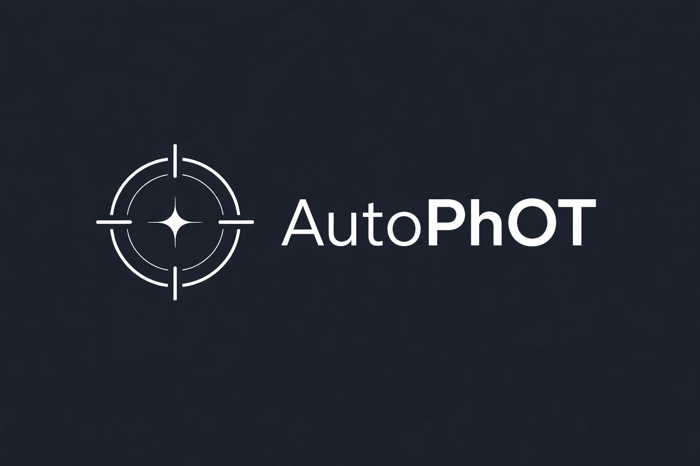
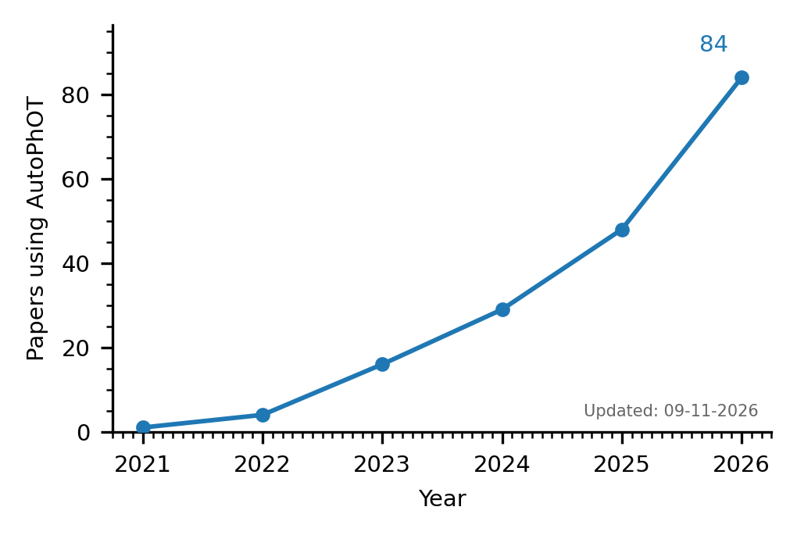

<div align="center">



<h1>AutoPhOT: Automated Photometry Of Transients</h1>

**Point it at your FITS frames, give it a target, get back a calibrated light curve.**

[](https://anaconda.org/astro-sean/autophot)
[](https://anaconda.org/astro-sean/autophot)
[](https://anaconda.org/astro-sean/autophot)
[](https://anaconda.org/astro-sean/autophot)

[Conda package](https://anaconda.org/astro-sean/autophot) | [Paper](https://ui.adsabs.harvard.edu/abs/2022A%26A...667A..62B) | [Report an issue](https://github.com/Astro-Sean/autophot/issues)

</div>

---

AutoPhOT is a photometry pipeline for transients and variable sources, built on [Photutils](https://photutils.readthedocs.io/) and [Astropy](https://www.astropy.org/). Feed it FITS images from any telescope, filter, or pixel scale and it will find your target in each frame, do the photometry, calibrate it against survey catalogs, and hand you one clean light curve.

It has been used in <!-- citation-count -->84<!-- /citation-count --> papers so far (updated: <!-- citation-date -->13-11-2026<!-- /citation-date -->; [full list on SciX](https://scixplorer.org/search?q=citations%28bibcode%3A2022A%26A...667A..62B%29&sort=date%20desc)).

> [!NOTE]
> AutoPhOT is developed and maintained by one person only. If you hit a problem, please open an issue on GitHub and I will get to it as soon as I can.

<h2 align="center">What it does</h2>

1. Sorts your frames by telescope, instrument, and filter, then checks or re-solves the WCS with astrometry.net and Gaia DR3. SIP and TPV distortion are handled.
2. Cleans each image: cosmic-ray rejection, satellite-trail detection, background estimation, FWHM measurement.
3. Runs aperture and PSF photometry at the target position, using an empirical PSF built from stars in the frame itself.
4. Calibrates against Gaia DR3, Pan-STARRS, SDSS, APASS, 2MASS, Legacy Survey, SkyMapper, and more, with per-filter routing and Gaia XP synthetic photometry.
5. Optionally subtracts a template (SFFT, HOTPANTS, or ZOGY) and scores every difference image for quality.
6. Measures limiting magnitudes by injecting and recovering artificial sources.

<h2 align="center">Installation</h2>

### Conda (recommended)

```bash
conda install -n base -c conda-forge conda-libmamba-solver
conda config --set solver libmamba

conda create -n autophot -c conda-forge -c astro-sean python=3.12 autophot
conda activate autophot

pip install sfft==1.7.3 sip_tpv==1.1  # not on conda channels
```

AutoPhOT needs Python 3.12 and photutils>=3.1, which the conda package and pip installs pull in automatically. To check everything is working:

```bash
python -c "from autophot import AutomatedPhotometry; print('OK')"
autophot-main -h
```

### From source

```bash
git clone https://github.com/Astro-Sean/autophot.git
cd autophot
pip install .
```

For a development checkout use `pip install -e .`. Optional extras cover RefCAT2 queries and the non-default aligners: `pip install ".[refcat,aafitrans,spalipy,tweakwcs,chi2-shift]"` or `pip install ".[all]"`.

`environment.yml` pins every dependency if you want a fully reproducible setup:

```bash
conda env create -f environment.yml
conda activate autophot
pip install -e .
```

<h2 align="center">Documentation</h2>

The full pipeline reference is [`docs/autophot_methods.pdf`](docs/autophot_methods.pdf). It walks through every processing stage in order, gives the photometry, calibration, and detection maths, and documents all parameters in `default_input.yml` with defaults and usage notes. The LaTeX source (`docs/autophot_methods.tex`, with tables generated from `default_input.yml`) sits in the same folder if you need to rebuild it.

The [`examples/run_autophot.ipynb`](examples/run_autophot.ipynb) notebook runs a real subtraction end to end and carries a reference appendix covering folder layouts, catalog routing, alignment and subtraction options, photometry settings, and post-processing.

<h2 align="center">Quick start</h2>

```python
from autophot import AutomatedPhotometry

config = AutomatedPhotometry.load()
config["fits_dir"] = "/path/to/your/images"
config["target_name"] = "SN2026abc"
config["target_ra"] = 123.456789
config["target_dec"] = -12.345678

output_file = AutomatedPhotometry.run_photometry(default_input=config)
```

A few things worth knowing up front:

- `from autophot import list_parameters; list_parameters()` prints every config key and its default.
- FITS headers must carry `TELESCOP`, `INSTRUME`, and a bandpass keyword (e.g. `FILTER`); images without them are skipped.
- `config["nCPU"] = 4` (or `AUTOPHOT_NCPU=4`, which takes precedence) processes images in parallel, each with its own log. Worker settings like `photometry.aperture_n_jobs` multiply `nCPU`, so keep the product at or below your core count. `nGPU` / `AUTOPHOT_NGPU` pins workers to GPUs round-robin.
- `python -m autophot.batch_main -f im1.fits im2.fits -c config.yml --jobs 4` (or `autophot-batch`) runs a file list without a driver script.

<h2 align="center">Folder layout</h2>

`fits_dir` is scanned recursively; outputs go to a `<fits_dir>_<outdir_name>` sibling (default `photometry_REDUCED`). Templates live in `fits_dir/templates/<band>_template/`; for nested datasets, the `templates/` folder nearest to each science image wins. The example notebook shows the flat and nested trees in detail.

<h2 align="center">Command-line tools</h2>

| Command | Purpose |
|---------|---------|
| `autophot <sub>` | Unified CLI: `run`, `driver`, `batch`, `inspect-telescope`, `gaia-curves` |
| `autophot-main` | Run the full photometry pipeline |
| `autophot-driver` | Interactive driver with template setup |
| `autophot-batch` | Batch driver over many images |
| `autophot-gaia-curves` | Build a Gaia custom catalog from transmission curves |
| `autophot-inspect-telescope` | Inspect telescope header keywords |

<h2 align="center">Repository layout</h2>

All pipeline code lives in the `autophot/` package: `pipeline/` (prepare,
wcs, background, cosmic, fwhm, mask, telescope, main), `photometry/`
(aperture, psf, differential, galfit_host), `calibration/` (catalog,
zeropoint, color_correction, filter_transformations), `subtraction/`
(templates, run_sfft, run_sex, run_IDC), `analysis/` (lightcurve, limits,
plot, QA helpers), `services/` (tns, additional_targets, download_legacy),
`core/` (functions, plotting_utils), `data/` (YAML configs + extinction),
`gaia_curves/` (Gaia XP catalogs). Import from `autophot.<sub>.<module>`,
e.g. `from autophot.analysis.lightcurve import plot_lightcurve`.

<h2 align="center">Citation</h2>



If AutoPhOT earns a place in your paper, please cite:

> Brennan, S. J., & Fraser, M. 2022, A&A, 667, A62

```bibtex
@ARTICLE{2022A&A...667A..62B,
       author = {{Brennan}, S.~J. and {Fraser}, M.},
        title = "{The AUTOmated Photometry Of Transients pipeline (AutoPhOT)}",
      journal = {\aap},
         year = 2022,
        month = nov,
       volume = {667},
          eid = {A62},
        pages = {A62},
          doi = {10.1051/0004-6361/202243067},
archivePrefix = {arXiv},
       eprint = {2201.02635},
 primaryClass = {astro-ph.IM},
       adsurl = {https://ui.adsabs.harvard.edu/abs/2022A%26A...667A..62B},
      adsnote = {Provided by the SAO/NASA Astrophysics Data System}
}
```
